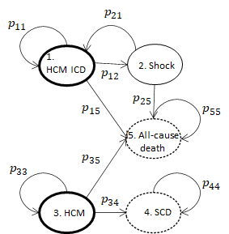

# Bayesian Models for Cost-Effectiveness Analysis of an SCD Risk Model in Hypertrophic Cardiomyopathy (HCM)

This repository contains code, model specifications, and (processed) data to perform a probabilistic cost-effectiveness (CE) analysis of a prognostic model for sudden cardiac death (SCD) in patients with hypertrophic cardiomyopathy (HCM). The analysis links a Bayesian survival model for SCD risk with a cohort Markov model that estimates long-term costs and quality-adjusted life years (QALYs) for alternative management strategies.

## Table of contents

- Background
- Aim
- Project structure
- Data
- Model overview
- Quick start
- Dependencies
- Reproducing the analysis
- Outputs
- Citation
- License & contact


## Background

Hypertrophic cardiomyopathy (HCM) is a common inherited cardiac condition and an important cause of sudden cardiac death (SCD), particularly in younger adults. Clinical risk prediction tools (for example, the HCM Risk-SCD model) estimate short-term SCD probability for individual patients but do not directly evaluate health-economic implications of management decisions informed by those predictions. This project combines a Bayesian prognostic model with a decision-analytic Markov simulation to quantify the cost-effectiveness of different management strategies across risk groups while propagating parameter uncertainty.

## Aim

To perform a probabilistic cost-effectiveness analysis that:

- Uses individual-level HCM data to fit a Bayesian survival/prognostic model for SCD and related events.
- Incorporates posterior parameter uncertainty from the Bayesian model into a cohort Markov model.
- Compares alternative management strategies (for example: usual care, risk-stratified ICD implantation strategies) across clinically relevant risk groups.
- Produces standard health-economic outputs (costs, QALYs, ICERs, CEACs) and visual summaries with appropriate uncertainty quantification.


## Project structure

- BUGS/
  - model.txt         : WinBUGS/OpenBUGS model specification
  - script.R          : R script to call WinBUGS/OpenBUGS and extract posterior samples
- data/               : Processed input data used by the analysis (generated by prep_study_data.R)
- images/             : Figures used in the README and reports (e.g. model_diagram.png)
- prep_study_data.R   : Data munging and creation of analysis-ready datasets
- main-ce-analysis.R  : Main script performing the cost-effectiveness analysis and simulations
- pop_counts_plot.R   : Helper script to create output plots of population counts / results
- output/             : (suggested) directory where analysis scripts save results and figures
- README.md           : This file


## Data

The analysis uses de-identified individual-level HCM patient variables. The repository does not include identifiable raw data. The `prep_study_data.R` script expects access to the original raw dataset and writes cleaned and (optionally) imputed datasets into the `data/` directory.

Key variables used by the model and analysis:

| Variable | Description |
|---|---|
| set | Imputed dataset indicator |
| centre | Centre identifier |
| id | Patient identifier |
| d | Event indicator (1 = SCD / appropriate ICD shock) |
| time | Follow-up time (years) |
| age | Age (years) |
| mwt | Maximal wall thickness (mm) |
| mwt2 | mwt squared (mwt^2) |
| la | Left atrial size (mm) |
| maxlvotg | Maximal LVOT gradient (mmHg) |
| fhxscd | Family history of SCD (binary) |
| nsvt | Non-sustained ventricular tachycardia (binary) |
| syncope | Syncope (binary) |

Note: The exact set of covariates used in the model and any pre-processing (centering, scaling, handling of missingness) are implemented in `prep_study_data.R`. If you have access to the raw data, run that script locally to produce the analysis-ready files in `data/`.


## Model overview

The analysis has two linked components:

1. Bayesian prognostic model (WinBUGS/OpenBUGS):
   - A survival or competing-risks model is fitted to individual-level data to estimate event probabilities and to obtain the joint posterior distribution of model parameters. Posterior samples are saved and later used as inputs for the economic model to propagate parameter uncertainty.

2. Cohort Markov model (R):
   - A discrete-time cohort Markov model simulates the long-term clinical and economic consequences of different management strategies. Posterior parameter samples from the Bayesian model are sampled into the cohort model so that uncertainty in risk prediction flows through to costs and QALYs.

The first-stage decision tree determines initial management (for example, whether an implantable cardioverter-defibrillator, ICD, is recommended or implanted), and the Markov model then projects downstream events, costs, and utilities.

<div class="figure" style="text-align: center">

<p class="caption">Markov model diagram. Bold circles represent starting states and dashed circles represent sink states.</p>
</div>


## Quick start

1. Clone the repository and open it in R or RStudio:

   git clone https://github.com/n8thangreen/HCMSCDCEanalysis.git
   
2. Prepare data (this requires access to the original raw dataset):
   - From an interactive R session: source("prep_study_data.R")
   - From a shell: Rscript prep_study_data.R
   This writes cleaned/imputed analysis files into the `data/` folder.

3. Fit the Bayesian model (requires WinBUGS/OpenBUGS or JAGS and an R interface):
   - Inspect `BUGS/script.R` to configure the interface (R2WinBUGS, BRugs, or a port to rjags).
   - Run the script to call BUGS and save posterior samples. For development, run short chains; for final analyses use longer chains and check convergence diagnostics.

4. Run the cost-effectiveness simulation:
   - From R: source("main-ce-analysis.R")
   - Or: Rscript main-ce-analysis.R
   The script reads posterior samples and data from `data/`, runs cohort simulations, and writes outputs into `output/`.

5. Generate figures and tables:
   - Run `pop_counts_plot.R` and other helper scripts to create plots in `output/`.


## Dependencies

Recommended software and R packages (not exhaustive):

- R (>= 3.6 recommended)
- R packages: dplyr, tidyr, data.table, ggplot2, readr, survival, matrixStats
- BUGS/JAGS: WinBUGS or OpenBUGS (or port code to JAGS and use rjags)
- R interfaces: R2WinBUGS, BRugs, or rjags depending on your local setup

To install common R dependencies:

```r
install.packages(c("dplyr","tidyr","data.table","ggplot2","readr","survival","matrixStats"))
# For WinBUGS/OpenBUGS interface: install.packages("R2WinBUGS") or install BRugs from source
```

Notes:
- WinBUGS/OpenBUGS must be installed on the same machine and paths configured in `BUGS/script.R` if using R2WinBUGS.
- If you cannot use Win/OpenBUGS, consider porting the BUGS model to JAGS and using rjags.


## Reproducing the analysis

Recommended, reproducible workflow:

1. Run `prep_study_data.R` to create `data/` files from the raw dataset (obey local data governance and storage rules).
2. Run `BUGS/script.R` to fit the Bayesian model and save posterior samples (record BUGS settings: number of chains, iterations, burn-in, thinning).
3. Run `main-ce-analysis.R` to perform the cohort Markov simulations and compute costs and QALYs under each strategy.
4. Run plotting and reporting scripts (e.g. `pop_counts_plot.R`) to create figures and summary tables in `output/`.

Tips:
- Use a reproducible seed (set.seed()) for stochastic simulations.
- Keep a record of software versions, seed values, and BUGS settings used for the final runs.
- Check model convergence (traceplots, R-hat or other diagnostics) before using posterior samples for the economic model.


## Outputs

Scripts save outputs (tables, plots) into `output/`. Typical outputs include:

- Cost and QALY summaries by strategy and risk group
- Incremental cost-effectiveness ratios (ICERs) and net monetary benefit calculations
- Cost-effectiveness acceptability curves (CEACs)
- Plots of population counts and state occupancy over time
- Posterior summaries and diagnostic plots for the Bayesian model


## Citation

When using these analyses, please cite the original clinical model and any relevant primary sources. Example clinical model citation:

O'Mahony C, et al. A novel clinical risk prediction model for sudden cardiac death in hypertrophic cardiomyopathy (HCM risk-SCD). European Heart Journal. [provide full citation details].

If you use this repository in published work, please provide a link to the repository and mention the specific scripts and settings used to generate results.


## License & contact

No license file is currently present in this repository. If you would like a permissive license applied, add a LICENSE file (e.g., MIT or GPL) or open an issue to request one.

For questions, bug reports, or contribution requests, please open an issue on GitHub or contact the repository owner: https://github.com/n8thangreen
