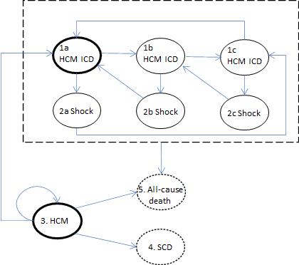
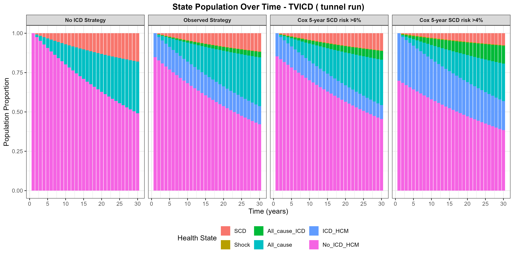
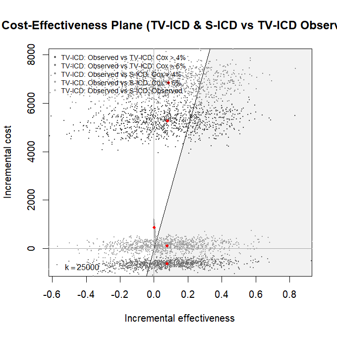
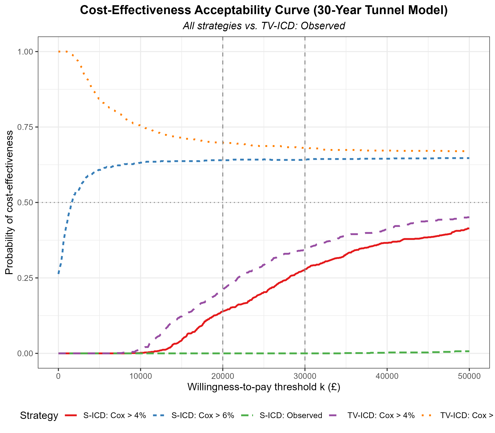
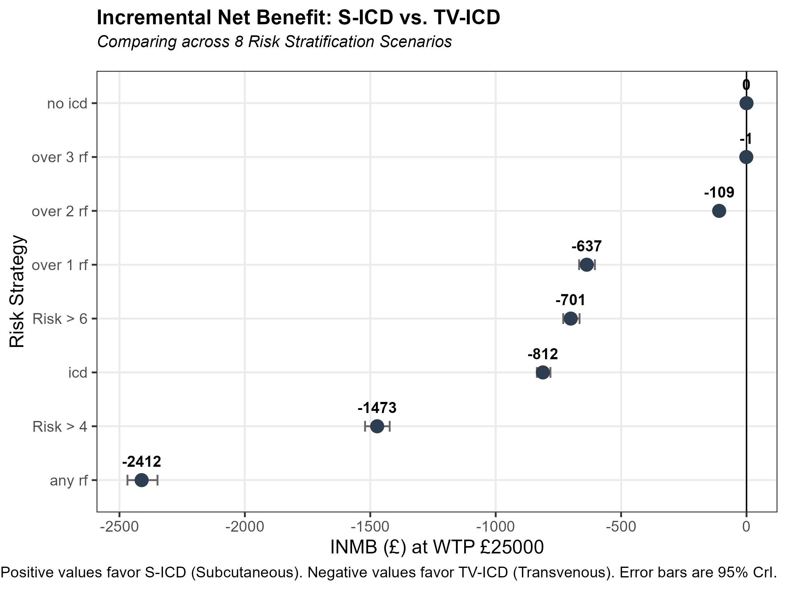
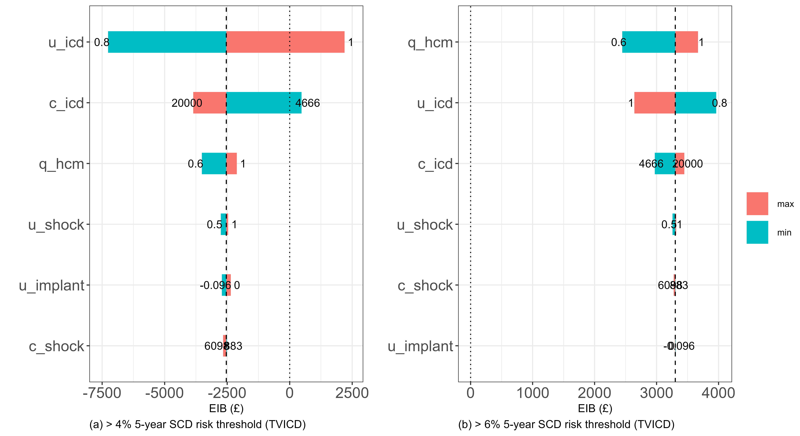
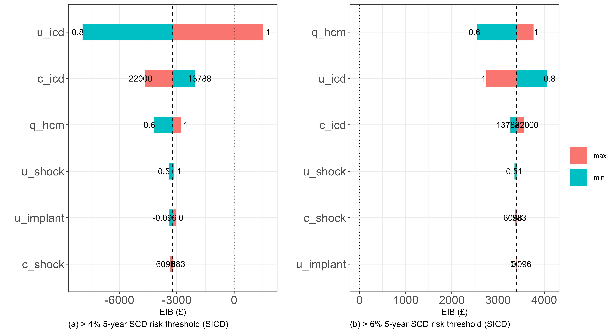

```{r setup, include=FALSE}
knitr::opts_chunk$set(echo = FALSE, warning = FALSE, message = FALSE)
library(dplyr)
library(readr)
library(knitr)
```

```{r load-data}
load(here::here("data/ipd_risk.RData"))
all_ce_results <- readr::read_csv(here::here("data/all_ce_model_results.csv"), show_col_types = FALSE)
load(here::here("data/ce_analysis_all_strat_s-icd_results.RData"))
```

```{r cohort-stats}
centre_tab <- dplyr::count(ipd_risk, centre)
centre <- centre_tab$centre
n <- centre_tab$n

cens_tab <- dplyr::count(ipd_risk, d)
cens <- cens_tab$d
nd <- cens_tab$n
```

# Introduction

Hypertrophic cardiomyopathy (HCM) is a common inherited heart muscle disorder and a leading cause of sudden cardiac death (SCD) in young adults.
Patients at high risk of SCD need to be identified so they can be offered lifesaving prophylactic treatment with an implantable cardioverter-defibrillator (ICD).
Contemporary guidelines recommend that sudden death risk is assessed using quantitative clinical risk prediction models [@OMahony2014; @Ommen2020], yet real-world ICD implantation rates vary substantially across international healthcare systems [@Nauffal2021].

In our previous cost-effectiveness analysis [@Green2024], we evaluated the European Society of Cardiology (ESC) 5-year HCM Risk-SCD prediction algorithm [@OMahony2014] for primary prevention transvenous ICD (TV-ICD) implantation over a 12-year time horizon without device replacement.
However, HCM patients are typically implanted at a young mean age (~48 years) and face decades of living with a device, requiring multiple generator replacements over their lifetime.
Furthermore, the clinical landscape has shifted with the widespread adoption of the subcutaneous ICD (S-ICD) [@Lambiase2022; @Knops2020].
By placing the electrode and generator entirely extrathoracically, the S-ICD eliminates intravascular lead placement and substantially reduces long-term lead-related complications and systemic device infections, as demonstrated in the landmark ATLAS [@Healey2022] and 8-year PRAETORIAN-XL [@Knops2024] trials.
Conversely, S-ICD systems carry a higher upfront hardware acquisition cost and a shorter median battery longevity (~8 to 8.7 years) compared with contemporary single-chamber TV-ICDs (~10 years), necessitating more frequent generator replacements over an extended time horizon.

This paper addresses this critical evidence gap by extending our Bayesian Markov cost-effectiveness framework to a 30-year time horizon using tunnel states to explicitly track device battery longevity and generator replacement cycles.
We evaluate the joint clinical and economic trade-offs between device modality (S-ICD vs. TV-ICD) and risk stratification thresholds (ESC 5-year SCD risk $>4\%$ and $>6\%$, individual risk factor counts, and observed clinical practice) from a UK National Health Service (NHS) perspective.

All code and data are publicly available on GitHub at `https://github.com/n8thangreen/HCMSCDCEanalysis`.

# Data and Model Parameters

The study cohort has been described in detail previously [@OMahony2014; @Green2024].
In brief, the dataset comprises $N =$ `r nrow(ipd_risk)` individuals with HCM followed up across six European centres: `r paste0(centre[1], " (", n[1], ")")`, `r paste0(centre[2], " (", n[2], ")")`, `r paste0(centre[3], " (", n[3], ")")`, `r paste0(centre[4], " (", n[4], ")")`, `r paste0(centre[5], " (", n[5], ")")`, and `r paste0(centre[6], " (", n[6], ")")`.
The mean age (SD) at baseline was `r round(mean(ipd_risk$age), 1)` (`r round(sd(ipd_risk$age), 1)`) years.

Health state utilities, resource use, and unit costs were obtained from contemporary clinical trials, UK NHS tariffs, and St Bartholomew's Hospital (Barts Health NHS Trust) procurement data (Table 1).
Under the UK NHS Payment Scheme and Specialised Services Devices Programme (SSDP), implantable defibrillator hardware is a High-Cost Tariff-Excluded Device reimbursed in addition to the Healthcare Resource Group (HRG) implantation procedure tariff (`EY02B`, £4,666).
To ensure a like-for-like comparison between modalities, our base-case analysis uses the combined NHS procedure tariff and Barts Health NHS Trust device hardware cost (£15,317 for TV-ICD vs. £17,434 for S-ICD), with tariff-only and broader European cost bounds (£4,666 to £22,000) evaluated in sensitivity analyses.
Costs per shock episode (£1,766) were taken from the UK CareLink healthcare resource utilization study [@Llewellyn2023], and device-specific complication rates and battery longevity were parameterized using PRAETORIAN-XL [@Knops2024], ATLAS [@Healey2022], and EFFORTLESS [@Lambiase2022].

| Parameter | Variable | TV-ICD (`tvicd`) | S-ICD (`sicd`) | Sensitivity Range / Distribution | Source |
|:---|:---|:---|:---|:---|:---|
| **Health Utilities (QALYs)** | | | | | |
| HCM without ICD | `q_hcm` | 0.88 / yr | 0.88 / yr | 0.60 -- 1.00 | @Sanders2005 |
| Living with ICD (multiplier) | `u_icd` | 0.90 | 0.90 | 0.80 -- 1.00 (0.95 scen.) | @Magnusson2020; @Holbrook2020; @Knops2020 |
| Shock state (multiplier) | `u_shock` | 0.875 | 0.875 | 0.50 -- 1.00 | @Buxton2006 |
| Implant procedure decrement | `u_implant` | -0.048 | -0.048 | -0.096 -- 0.00 | @Holbrook2020 |
| Implant complication decrement | `u_compl` | -0.096 | -0.096 | Point (-0.096) | @Holbrook2020 |
| **Costs (£)** | | | | | |
| Initial implant + device | `c_icd` | £15,317 | £17,434 | TV: £4,666--£20,000; S: £13,788--£22,000 | NHS `EY02B` + Barts Trust SSDP |
| Generator replacement | `c_icd_repl` | £15,317 | £17,434 | TV: £4,666--£20,000; S: £13,788--£22,000 | NHS `EY02B` + Barts Trust SSDP |
| Annual ICD follow-up | `c_appt` | £145 | £145 | Point (£145) | NHS `WF02A` [@NHSEngland2021] |
| Shock episode (hospitalisation) | `c_shock` | £1,766 | £1,766 | £883 -- £6,098 | @Llewellyn2023 |
| Device / lead infection | `c_inf` | £37,116 | £37,116 | Point (£37,116) | @Thijssen2014; NHS `EY17A` |
| Lead dislodgement / revision | `c_dis` | £6,146 | £6,146 | Point (£6,146) | @Thijssen2014; NHS `EY17A` |
| **Device & Clinical Parameters** | | | | | |
| Maximum device life (tunnel states, $T$) | `t_repl_max` | 15 years | 15 years | Forced replacement at $T$ | Model assumption |
| Median battery life | `repl_median` | 10 years (SE 0.5) | 8.5 years (SE 0.41) | Normal; S-ICD 8.5 years from EMBLEM, 95% CI 7.9--9.5 | Real-world LATITUDE / Registry; EMBLEM |
| Weibull shape of battery life | `repl_shape` | 5 (SE 0.5) | 5 (SE 0.5) | Gamma | Assumption (increasing hazard of battery depletion) |
| Initial implant complication | `p_compl` | 0.043 | 0.015 | Point | @Cunningham2012; @Knops2024; @Healey2022 |
| Initial infection probability | `p_inf_init` | 0.02277 | 0.007 | Point | @Thijssen2014; @Knops2024 |
| Initial dislodgement probability | `p_dis_init` | 0.00828 | 0.008 | Point | @Thijssen2014; @Knops2024 |
| Time horizon | `J` | 30 years | 30 years | 12 -- 30 years | Long-term replacement horizon |
| Discount rate (costs & QALYs) | `delta` | 3.5% | 3.5% | 0% -- 6.0% | NICE Reference Case |

: Base-case model parameters, sensitivity ranges, and data sources for Transvenous ICD (TV-ICD) and Subcutaneous ICD (S-ICD).

# Methods

## Tunnel-State Markov Model with Battery Replacement Cycles

To account for time-since-implant and periodic generator replacements over a $J = 30$-year horizon, we expanded our discrete-time annual Markov model [@Green2024] using tunnel states (Figure \@ref(fig:model)).
For a device with a maximum battery lifespan of $T = t_{\text{repl\_max}}$ years ($T = 15$ for both devices), the state space consists of $S = 2T + 4$ states:

1. **HCM with ICD Tunnel States ($1, \dots, T$)**: Patients implanted with an ICD enter State 1 at cycle $j = 1$ and advance from state $t$ to $t+1$ each year they remain free of shock and death. In each tunnel state $t$, patients who remain alive are replaced with probability $h_t$ (see the next section) and transition back to State 1 in the following cycle, triggering a generator replacement cost (`c_icd_repl`); otherwise they advance to state $t+1$. Replacement is certain at state $T$ ($h_T = 1$).
2. **ICD Shock Tunnel States ($T+1, \dots, 2T$)**: If a patient in ICD tunnel state $t$ experiences an appropriate or inappropriate shock, they enter the corresponding shock tunnel state $T+t$ for one cycle (incurring shock cost `c_shock` and utility multiplier `u_shock`). Surviving shocked patients are replaced with probability $h_t$ (back to State 1) or progress to ICD tunnel state $t+1$ in the next cycle.
3. **All-Cause Mortality with ICD ($2T+1$)**: Absorbing sink state for non-arrhythmic mortality in the ICD arm.
4. **HCM without ICD ($2T+2$)**: Starting state for patients not selected for ICD implantation under a given risk threshold.
5. **Sudden Cardiac Death ($2T+3$)**: Absorbing sink state for fatal arrhythmic events in the non-ICD arm.
6. **All-Cause Mortality without ICD ($2T+4$)**: Absorbing sink state for non-SCD mortality in the non-ICD arm.

Note that setting $T = 1$ (`t_repl_max = 1`) and $\text{c\_icd\_repl} = 0$ recovers the original 6-state memoryless model without battery replacement [@Green2024] as an exact special case.

```{r model, fig.align="center", out.width="85%", fig.cap="Tunnel-state Markov model diagram incorporating device battery lifespan and replacement cycles."}

```

## Survival-Curve Model of Device Battery Longevity

An earlier version of the model replaced every device deterministically after exactly 10 (TV-ICD) or 8 (S-ICD) years.
This forces an artificial step-function into the Markov trace, with all replacement costs, replacement-related complications and disutilities falling in a single cycle.
In practice battery depletion varies between devices.
We therefore modelled time to generator replacement with a Weibull survival function $S(t) = \exp\{-(t/\lambda)^{k}\}$, with shape $k > 1$ so that the hazard of battery depletion increases with device age.
The scale was parameterised from the median battery life $m$ as $\lambda = m / (\log 2)^{1/k}$, so that $S(m) = 0.5$.
The median was set to 10 years for TV-ICD and 8.5 years for S-ICD (EMBLEM; 95% CI 7.9 to 9.5), close to the fixed lifespans used previously, and the shape was set to $k = 5$.

The annual probability that a device in tunnel state $t$ (time since implant, in years) is replaced is the discrete-time hazard
$$h_t = 1 - \frac{S(t)}{S(t-1)}, \quad t = 1, \dots, T,$$
with $h_T = 1$ so that all devices are replaced by the maximum lifespan $T = 15$ years (the Weibull survival probability at 15 years is below 1% for both devices).
In each cycle a patient in ICD tunnel state $t$ who does not die and is not shocked is replaced with probability $h_t$ (returning to State 1) and otherwise moves to state $t+1$; patients in shock tunnel states follow the same rule after surviving the shock cycle.
Replacement costs and disutilities are therefore incurred in proportion to the occupancy of State 1 after the first cycle, rather than in a single cycle.
The deterministic fixed-lifespan model is recovered as the special case $h_t = 0$ for $t < T$.

In the probabilistic sensitivity analysis the replacement probabilities are treated in the same way as the MCMC posterior draws of the other transition probabilities.
For each simulation we draw the median battery life from a Normal distribution (truncated above zero) and the shape from a Gamma distribution, using the standard errors in Table 1, compute the vector $(h_1, \dots, h_T)$, and pass this as a simulation-specific row of the transition probability array.
The standard error of the S-ICD median (0.41 years) was derived from the reported 95% confidence interval; that of the TV-ICD median was assumed to be 5% of the median, and the shape standard error was assumed to be 10% of the shape.
The Weibull curve is assumed to apply from implantation; no peri-operative mortality is attached to replacement, and replacement carries the complication risk `p_repl_compl` and disutility `u_repl` as before.
## Bayesian Inference of Transition Probabilities

For each risk stratification rule (Observed practice, ESC 5-year SCD risk $>6\%$ and $>4\%$, $\ge 1, 2, 3$ risk factors, and No ICD), individual patient follow-up counts were aggregated into annual transition matrices and fitted in JAGS/WinBUGS [@Lunn2000; @R2021] to obtain 1,000 posterior MCMC draws of the transition probability matrices.

# Results

## Base-Case Cost-Effectiveness: TV-ICD and S-ICD (30-Year Tunnel Model)

Table 2 presents the 30-year expected total costs, QALYs, incremental outcomes, incremental cost-effectiveness ratios (ICERs), and incremental net monetary benefits (INB at a willingness-to-pay threshold of $k = £25,000$/QALY) per patient for both TV-ICD and S-ICD relative to the observed clinical practice strategy within each device modality.

```{r table-baseline}
tab_disp <- all_ce_results %>%
  mutate(
    Mean_Cost = sprintf("£%s", format(round(Mean_Cost, 0), big.mark = ",")),
    Mean_QALY = sprintf("%.2f", Mean_QALY),
    Incremental_Cost = ifelse(Strategy == "Observed", "Ref", sprintf("£%s", format(round(Incremental_Cost, 0), big.mark = ","))),
    Incremental_QALY = ifelse(Strategy == "Observed", "Ref", sprintf("%.3f", Incremental_QALY)),
    ICER_str = case_when(
      Strategy == "Observed" ~ "Reference",
      ICER < 0 & as.numeric(Incremental_QALY) > 0 ~ sprintf("Dominates (£%s/QALY)", format(round(ICER, 0), big.mark = ",")),
      TRUE ~ sprintf("£%s/QALY", format(round(ICER, 0), big.mark = ","))
    ),
    INB = ifelse(Strategy == "Observed", "Ref", sprintf("£%s", format(round(INB, 0), big.mark = ",")))
  ) %>%
  select(Device, Model, Strategy, Mean_Cost, Incremental_Cost, Mean_QALY, Incremental_QALY, ICER = ICER_str, `INB (£25k)` = INB)

knitr::kable(tab_disp, caption = "30-year tunnel-state cost-effectiveness results per patient by device modality (reference: Observed strategy within each device).")
```

Across a 30-year time horizon with battery replacements modelled by Weibull survival curves (median battery life 10 years for TV-ICD and 8.5 years for S-ICD):

* **Within each device modality, the $>6\%$ 5-year SCD risk threshold dominates observed clinical practice**:
  * For **TV-ICD** (median battery life 10 years), the $>6\%$ risk threshold reduces mean lifetime cost by £576 per patient (£5,501 vs. £6,077) while increasing QALYs by $+0.109$ (13.02 vs. 12.91 QALYs), yielding a positive INB of **£3,302** per patient at $k = £25,000$/QALY.
  * For **S-ICD** (median battery life 8.5 years), the $>6\%$ risk threshold saves £684 per patient (£6,271 vs. £6,954) for a $+0.109$ QALY gain, yielding an INB of **£3,401** per patient relative to S-ICD under observed selection.
* **The $>4\%$ 5-year SCD risk threshold implants more than double the number of patients (1,103 vs. 542)**, which substantially increases initial implantation and repeat battery replacement costs over 30 years (£11,327/patient for TV-ICD; £12,935/patient for S-ICD) for essentially no additional QALY gain over the $>6\%$ threshold ($-0.0004$ QALYs for TV-ICD; $+0.002$ for S-ICD), resulting in ICERs above the standard NICE threshold (£48,326/QALY for TV-ICD and £53,886/QALY for S-ICD vs. Observed).

```{r statepop, fig.align="center", out.width="95%", fig.cap="Cohort state occupancy proportions over the 30-year time horizon under the tunnel-state model."}

```

## Joint Comparison: S-ICD vs. TV-ICD Across Risk Stratification Rules

When comparing S-ICD and TV-ICD Strategies jointly against the benchmark of current clinical practice (**TV-ICD: Observed**, Figure \@ref(fig:cecombined)):

* Switching from **TV-ICD: Observed** (£6,217, 13.82 QALYs in the PSA) to **S-ICD combined with the $>6\%$ Cox risk algorithm** (`S-ICD: Cox > 6%`, £6,334, 13.90 QALYs) is **cost-effective at the NICE threshold**, with an **ICER of £1,482/QALY**, an expected incremental benefit (EIB) of **+£1,858**, and a **64.3% probability of cost-effectiveness** at $k = £25,000$/QALY.
* The same risk threshold applied with a TV-ICD (`TV-ICD: Cox > 6%`, £5,577, 13.90 QALYs) dominates TV-ICD Observed (EIB **+£2,552**, 68.7% probability of cost-effectiveness), so most of the benefit comes from improved targeting rather than device choice.
* However, within any *fixed* risk stratification rule (Table 3 and Figure \@ref(fig:inmbforest)), S-ICD incurs higher 30-year cumulative costs than TV-ICD ($+£764$ per patient under Risk $>6\%$; $+£884$ under Observed; $+£1,602$ under Risk $>4\%$). Although S-ICD reduces acute implant and lead complications (`1.5%` vs. `4.3%`), the combination of a £2,117 higher device cost per implant/replacement and a shorter median battery life (8.5 vs. 10 years, so devices are replaced earlier and more often over 30 years) outweighs the acute complication savings when long-term living-with-ICD utility (`u_icd`) is assumed equal between devices.

```{r table-all-strat}
tab_strat <- ce_data %>%
  mutate(
    TVICD_Cost = sprintf("£%s", format(round(TVICD_Cost, 0), big.mark = ",")),
    SICD_Cost  = sprintf("£%s", format(round(SICD_Cost, 0), big.mark = ",")),
    Delta_C    = sprintf("+£%s", format(round(Delta_C_Mean, 0), big.mark = ",")),
    Delta_E    = sprintf("+%.4f", Delta_E_Mean),
    INMB_CrI   = sprintf("£%s (£%s, £%s)",
                         format(round(INMB_Mean, 0), big.mark = ","),
                         format(round(INMB_Lower, 0), big.mark = ","),
                         format(round(INMB_Upper, 0), big.mark = ","))
  ) %>%
  select(Strategy = Description, `TV-ICD Cost` = TVICD_Cost, `S-ICD Cost` = SICD_Cost,
         `Delta Cost (S - TV)` = Delta_C, `Delta QALY (S - TV)` = Delta_E,
         `INMB at £25k (95% CrI)` = INMB_CrI)

knitr::kable(tab_strat, caption = "Head-to-head comparison of S-ICD versus TV-ICD within each of the 8 risk stratification rules over 30 years (WTP = £25,000/QALY).")
```

```{r cecombined, fig.align="center", out.width="48%", fig.show="hold", fig.cap="Combined Probabilistic Sensitivity Analysis (30-year tunnel model) comparing TV-ICD and S-ICD strategies against TV-ICD Observed practice: (left) Cost-Effectiveness Plane and (right) Cost-Effectiveness Acceptability Curves (CEAC)."}


```

```{r inmbforest, fig.align="center", out.width="75%", fig.cap="Incremental Net Monetary Benefit (INMB at WTP £25,000/QALY) of S-ICD vs. TV-ICD across all 8 risk stratification scenarios."}

```

## Sensitivity Analyses

Figure \@ref(fig:tornado) displays the one-way deterministic sensitivity analysis (DSA) tornado plots for Expected Incremental Benefit (EIB at $k = £25,000$/QALY) for TV-ICD and S-ICD.
Consistent with our 12-year analysis [@Green2024], the dominant driver of cost-effectiveness across a 30-year horizon is the health-related quality of life multiplier associated with living with an ICD (`u_icd`), followed by baseline HCM utility (`q_hcm`) and device acquisition/replacement cost (`c_icd`).
In particular, if avoiding transvenous leads with an S-ICD yields even a modest chronic quality-of-life advantage (e.g., improving `u_icd` from `0.90` to `0.92`--`0.95` due to reduced lead anxiety or avoidance of long-term intravascular extraction morbidity), S-ICD becomes directly cost-effective over TV-ICD within the $>6\%$ risk group.

```{r tornado, fig.align="center", out.width="90%", fig.cap="One-way deterministic sensitivity analysis tornado plots of Expected Incremental Benefit (EIB, £ at WTP £25,000) for (top) TV-ICD and (bottom) S-ICD under the >4% and >6% 5-year SCD risk thresholds."}


```

# Discussion

By expanding our Bayesian Markov model to a 30-year horizon with tunnel states for generator replacement cycles, this study, which models device battery life with Weibull survival curves rather than fixed replacement times, provides two key insights for HCM clinical practice and health technology assessment:

1. **Risk Stratification Efficiency Can Fund Technological Innovation**:
   Adopting the ESC $>6\%$ 5-year SCD risk threshold rather than historic/unstructured clinical selection reduces unnecessary implantations in low-risk patients who never experience a life-saving shock.
   Over 30 years, this improved targeting makes **S-ICD under the $>6\%$ threshold cost-effective compared with current observed TV-ICD practice** (ICER £1,482/QALY), because the savings from avoiding low-yield implants largely offset the higher hardware and replacement costs of S-ICD.
2. **Battery Longevity and Chronic HRQoL Drive the S-ICD vs. TV-ICD Trade-off**:
   In a head-to-head comparison within the same risk stratum, S-ICD's lower perioperative complication and infection rates [@Knops2024; @Healey2022] are outweighed financially over 30 years by its £2,117 higher device cost and shorter median battery life (8.5 vs. 10 years, requiring earlier and more frequent generator replacement over three decades).
   Consequently, from a pure NHS payer perspective, S-ICD is most economically attractive when targeted to patients with higher infection/lead-failure risk, younger patients in whom transvenous lead failure accumulates over decades, or when S-ICD confers a chronic quality-of-life benefit (`u_icd`) over intravascular leads.

\newpage
# References

<div id="refs"></div>
